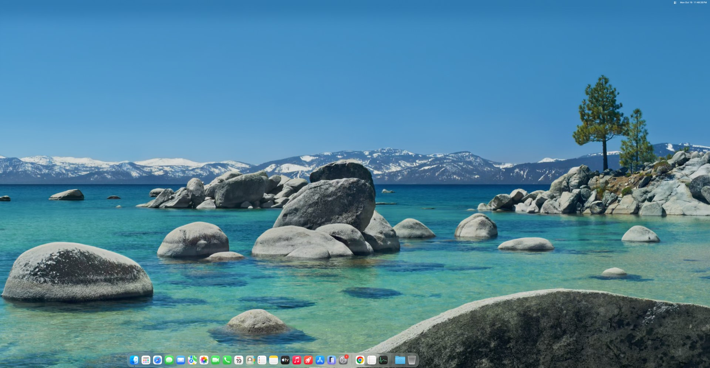
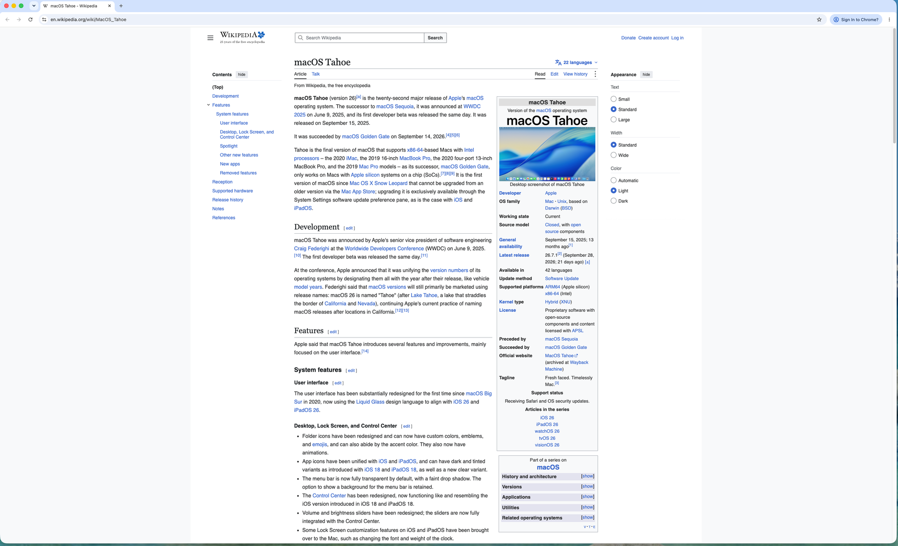
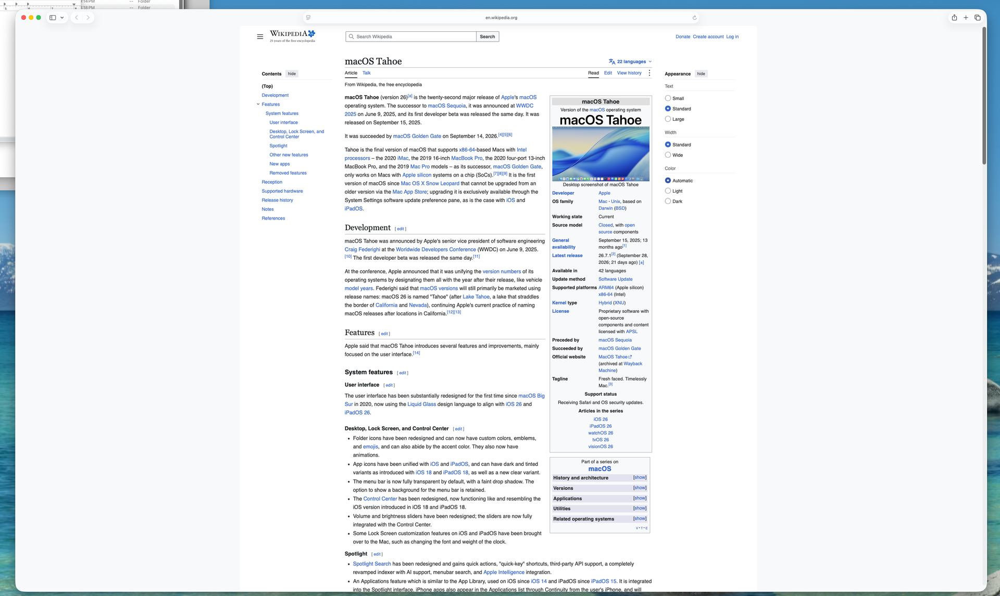

# reims-vgpu on Windows: macOS Tahoe with GPU acceleration on WHPX

[](LICENSE)

macOS 26 "Tahoe" running in QEMU on Windows 11, at 5120x2160 and 240 Hz, with accelerated graphics from the guest's own, unmodified Apple GPU driver.

## What this is

This is the Windows/WHPX port of [steelbrain/reims-vgpu](https://github.com/steelbrain/reims-vgpu), a virtual GPU for macOS guests. macOS already ships a paravirtual GPU driver, `AppleParavirtGPU.kext`. reims-vgpu provides the QEMU device that driver attaches to, decodes the guest's Metal command stream on the host and executes it through Vulkan; the [metal2vulkan](https://github.com/MAXZVER/metal2vulkan) translator turns Metal shaders (AIR) into SPIR-V. There is no custom guest driver and no kext to install.

This fork takes that design to a Windows host: QEMU runs on the Windows Hypervisor Platform (WHPX), the guest is macOS Tahoe, and the work has gone into making it fast and stable enough to use all day. It is the daily work machine of the fork's owner: Safari, Chrome, VS Code, the Claude desktop app and Microsoft Office all run in it, with sound and USB passthrough.

## Screenshots


*The Tahoe desktop and Dock, guest at 5120x2160 (cropped).*


*Chrome with Skia Graphite (Dawn on Metal), rendered through the device: toolbar icons, page and text.*


*Safari.*

## Status

| Area | State |
|---|---|
| Guest | macOS Tahoe (macOS 26), stock `AppleParavirtGPU` driver |
| Host | Windows 11, QEMU with WHPX, Vulkan GPU on the host |
| Display | 5120x2160 at 240 Hz, 24 vCPUs; Retina (HiDPI) modes available |
| Scaled present | Guest below the panel size, scaled on the host: FSR 1.0 EASU, optional RCAS and NVIDIA Image Scaling |
| Apps in daily use | Safari, Chrome, VS Code, Claude desktop app, Microsoft Office |
| Sound | virtio-sound with a device-side jitter buffer |
| USB passthrough | Keyboard, Bluetooth adapter and trackpad work on our setup; Ctrl+Alt+M hands the keyboard back to Windows. Host-specific, not turnkey |
| Networking | User-mode networking (slirp), with a Windows `FD_SETSIZE` fix so new connections do not stall |
| Reference hosts | Intel Core i7-14700K + RTX 4060 (main); AMD Ryzen 9 7950X + RTX 4090. A contributor runs it on a Ryzen 9 3900X + RTX 3080 |

Newest tested work lives on `master` of all three forks.

## Performance

Measured on the Intel i7-14700K + RTX 4060 host at 5120x2160, 24 vCPUs. These are our own runs: each test alternates its arms inside one guest boot, because the guest drifts between boots. They describe this one machine and are not a benchmark of anyone else's.

| Scene | Result |
|---|---|
| Apple Maps, full screen at 5K | ~54.5 fps |
| Heavy web dashboard page | ~70 fps |
| Safari canvas | ~59 fps |
| WebGL | ~45 fps |
| Chrome, scrolling a heavy page | ~150 fps |
| Safari, text scrolling | ~229 fps |
| Mission Control animation | ~150-200 fps |
| VS Code | ~37 fps |

Safari holds page rendering near 60 fps unless the WebKit preference `PreferPageRenderingUpdatesNear60FPSEnabled` is switched off in the guest. That is a guest setting, not a device limit.

## How it works

```
guest app
  -> Metal
  -> AppleParavirtGPU.kext          (stock macOS driver, unmodified)
  -> QEMU reims-vgpu device         (PCI, runs on WHPX)
  -> Rust: decode the command stream, schedule, execute
  -> metal2vulkan                   (Metal shaders / AIR -> SPIR-V)
  -> Vulkan                         (host GPU)
  -> host window present            (aspect-fit, optional EASU/RCAS/NIS)
```

Windows-specific engineering in this fork:

- **WHPX dirty-page tracking.** The default harvest is write-protection based, with page hashing so that pages which sync clean are skipped. This is what makes 5K scanout affordable under WHPX.
- **Profile-guided builds.** LLVM PGO for the Rust crates and gcc PGO for the C side of QEMU. A plain release build works and is simply slower.
- **Draw merging (on by default).** Runs of small draws, such as Core Animation quads or map features, fold into one prepared record with sub-draws. A page with thousands of small quads went from about 49 to 69-71 fps while dragged; Apple Maps gained 10-17 %.
- **Compositor-first scheduling (on by default).** The channel that presents is drained first.
- **Networking fix.** `FD_SETSIZE` is 1024 on Windows; winsock silently ignored sockets past 64, which stalled new sites in the guest browser.
- **Crash and freeze diagnostics.** An unhandled exception prints every thread's frames and writes a minidump; a vCPU stuck out of the hypervisor for over 2 s dumps all stacks once per episode.
- **Guest audio input without a host microphone** no longer freezes the VM for seconds at a time.

## Building

Three repositories are involved:

- this one, [MAXZVER/reims-vgpu](https://github.com/MAXZVER/reims-vgpu) (`master`)
- `vendor/qemu`, a submodule pointing at [MAXZVER/qemu-reims-vgpu](https://github.com/MAXZVER/qemu-reims-vgpu) (`master`)
- [MAXZVER/metal2vulkan](https://github.com/MAXZVER/metal2vulkan) (`master`), expected as a sibling checkout `../metal2vulkan`, which `Cargo.toml` patches in

```bash
git clone --recurse-submodules https://github.com/MAXZVER/reims-vgpu.git
git clone https://github.com/MAXZVER/metal2vulkan.git   # next to reims-vgpu
cd reims-vgpu
# from an MSYS2 UCRT64 shell with a Rust toolchain installed:
scripts/qemu-build/qemu-build.sh --target x86_64 --backend vulkan
```

A full step-by-step Windows guide and the VM setup itself (OpenCore, installing macOS) are not written yet. If you want to try this and get stuck, please open an issue or ask a question; that is how the guide will get written. One thing worth knowing now: a freshly installed macOS needs `METAL_ERROR_MODE=3` in the global preferences of the Data volume, because the device does not report a Metal target architecture.

## Known issues

- WebGPU: copying a texture into a canvas (`copyTextureToTexture`) and a render pass with no draws that only resolves a multisample texture still produce black. Chrome's own UI does not use either.
- HiDPI (Retina) modes stop at 2560x1080 points on a 5120x2160 panel. Larger backings (a 3456-point mode needs 6912x2916) overran the 8 GiB card's memory and crashed the NVIDIA driver, so they are not offered.
- Safari video and sound broke for up to ~2 s at Space switches on a long-running guest: our guest helper kext asks for physically contiguous surfaces (cheaper dirty tracking), and on fragmented memory each search for a 42 MB window-capture surface took that long. The helper now backs off for minutes after one slow search; verified in the lab and in daily use; short cuts are still reported and being measured.
- 5K throughput is bound by guest-page dirty tracking and by the guest WindowServer's single-threaded Core Animation CPU on heavy pages.

## Contributing

Pull requests go to `master`. Please keep a change to one concern and include a before/after from one boot with the arms alternated. Issues are welcome, and reports from other hardware are especially useful: say which CPU, GPU and Windows build you ran, because the defaults were tuned on one Intel and one AMD machine.

## Credits and license

Built on the work of [steelbrain](https://github.com/steelbrain): [reims-vgpu](https://github.com/steelbrain/reims-vgpu), [qemu-reims-vgpu](https://github.com/steelbrain/qemu-reims-vgpu) and [metal2vulkan](https://github.com/steelbrain/metal2vulkan). Thanks to Nouradawy for pull requests and to everyone who opened issues and tested on their own hardware.

Licensed under LGPL-3.0-or-later, as upstream. See [LICENSE](LICENSE).

The upstream project's own documentation, including the Linux/KVM and Apple Silicon pathways, is preserved in [README-upstream.md](README-upstream.md).
